# Kakinada Car Decors (KCD)

**An inventory, billing and fitting app for a car-accessories shop, with an AI assistant that asks before it changes anything.**

Sell at the counter · receive supplier goods · track every piece of stock · give quotations · run fitting jobs · GST bills · AI help with bills and shop questions.

- **Live app:** [kcd.mmcarcarekakinada.co.in](https://kcd.mmcarcarekakinada.co.in/) (partner sign-in required; it holds private shop records)
- **Stack:** Python · FastAPI · Pydantic · PydanticAI · PostgreSQL · SQLAlchemy · Alembic · React · TypeScript · Vite · Tailwind

> **About this repository.** The code here is the **evaluation snapshot from 9–10 October 2026**: the autonomous inventory worker, partner approvals and verified PostgreSQL operations, tested with **synthetic data only**. The shop's day-to-day product has kept growing in a private repository. The architecture, diagrams and explanations below describe the **current** product, so some features (quotations, fitting jobs, GST, the SQL-based assistant) are newer than the code in this repository. The [setup](#9-run-this-repository) and [test](#10-what-i-tested-in-this-snapshot) sections apply to the code here. No passwords, keys, customer data or shop records are in this repository.

---

## Contents

1. [What the app does](#1-what-the-app-does)
2. [Architecture](#2-architecture)
3. [How one click travels through the code](#3-how-one-click-travels-through-the-code)
4. [The golden rules of stock](#4-the-golden-rules-of-stock)
5. [Main features](#5-main-features)
6. [The database](#6-the-database)
7. [Security and privacy](#7-security-and-privacy)
8. [The AI assistant](#8-the-ai-assistant)
9. [Run this repository](#9-run-this-repository)
10. [What I tested in this snapshot](#10-what-i-tested-in-this-snapshot)
11. [Limits and next work](#11-limits-and-next-work)
12. [Glossary](#12-glossary)
13. [Credits](#13-credits)

---

## 1. What the app does

The shop sells car accessories (seat covers, mats, lights, wipers, perfumes…) and fits them on customers' cars. Before this app there was no stock software, only bills and memory. KCD is a website that works on phones and the shop computer.

| Who | What they do in the app |
| --- | --- |
| **Partner** (owner) | Everything: prices, supplier bills, approvals, quotations, fitting jobs, customers, GST, settings, AI assistant |
| **Staff** | Make sales at the partner's price, count goods that arrive, check stock. Staff never see buying prices. |

**In one line:** React shows it → FastAPI checks it → PostgreSQL remembers it → business rules protect it → the AI helps (but asks first) → tests prove it.

> **Important idea:** everyday work (selling, receiving, counting) never needs AI. If AI is switched off or its monthly budget runs out, the shop keeps working.

---

## 2. Architecture

### 2.1 Who talks to whom

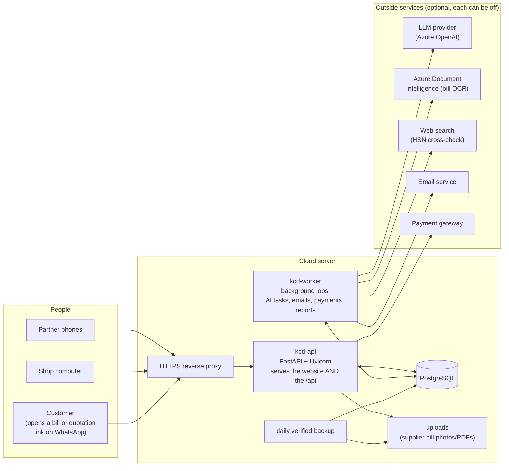

1. A partner opens the website on a phone; the proxy gives it HTTPS.
2. **kcd-api** (FastAPI) sends the React website and answers every `/api/...` request.
3. Everything important is saved in **PostgreSQL**.
4. Slow or outside work (AI, email, payment checks) is done by a second program, **kcd-worker**, so the counter never waits.
5. Outside services are optional. With none of them, sales, stock and bills still work.

### 2.2 The layers inside the code

A request always goes **down** the layers and the answer comes back **up**.

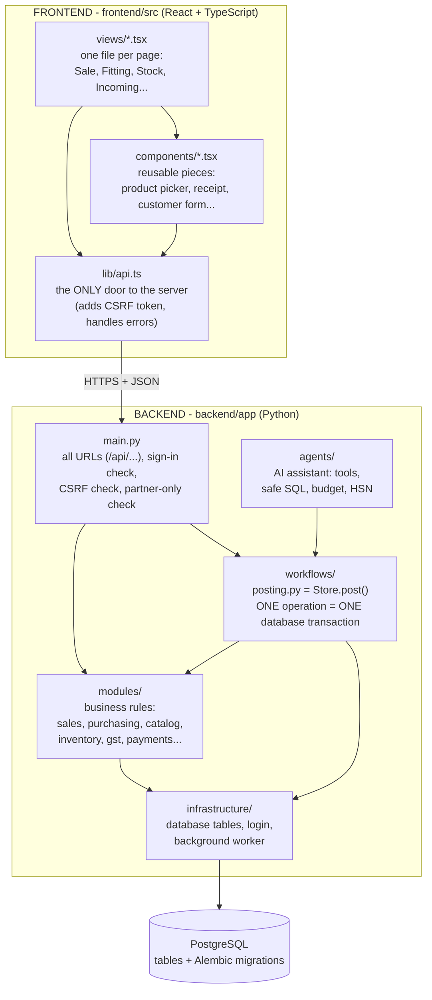

| Layer | Folder | Job in plain words |
| --- | --- | --- |
| Pages | `frontend/src/views` | What the person sees and taps |
| Server door | `backend/app/main.py` | Every URL. "Are you signed in? A partner? Is this request really from our website?" |
| Safe saving | `backend/app/workflows/posting.py` | Saves an operation all-or-nothing, exactly once |
| Shop rules | `backend/app/modules/` | "You can't sell what you don't have", GST maths, quotations, fitting… |
| AI | `backend/app/agents/` | The assistant and its tools |
| Plumbing | `backend/app/infrastructure/` | Database tables, login sessions, background worker |
| Memory | PostgreSQL + `backend/alembic/versions/` | Tables, and the history of every change to them |

---

## 3. How one click travels through the code

Following **"Confirm sale"** for 2 seat covers, paid by UPI:

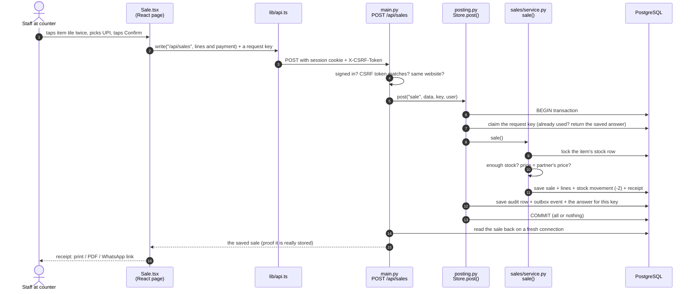

| Safety idea | What it means |
| --- | --- |
| **Request key** (idempotency) | If the phone's internet drops and the sale is sent twice, the second one returns the first result. Never a double sale. |
| **Row lock** | Two phones selling the **last** piece at the same second: one wins, the other gets "Not enough sellable stock". |
| **One transaction** | Sale, stock change, receipt and audit row are saved together or not at all. |
| **Read-back** | The answer shown to the user is read back from the database, not assumed. |

---

## 4. The golden rules of stock

1. **A supplier bill is not stock.** A bill creates *incoming* stock. Only **counting the goods** when they physically arrive adds *available* stock.
2. **Three buckets per item:** `available` (sellable) · `damaged` · `quarantined` (set aside). Only `available` can be sold.
3. **Stock can never go below zero.** The database itself refuses it (`CHECK available >= 0`).
4. **Every change is a movement** that points to the document (sale, receipt, return…) that caused it.
5. **Posted records are never edited or deleted.** Mistakes are fixed by a new linked record (return, reversal, stock count).
6. **Exact items only.** "Seat cover" is a *family*; "Seat cover, Swift, black, set" is the exact **variant** that owns stock. Pack sizes are saved only after someone confirms them.
7. **Services have no stock.** Fitting labour and other charges never move stock.
8. **Money is whole paise.** ₹1,250.50 is stored as `125050`.

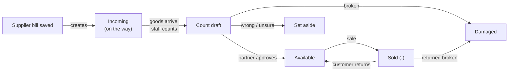

---

## 5. Main features

| Page | What it does |
| --- | --- |
| **Make sale** | Items → customer (or walk-in) → payment (cash / UPI / card / credit / online) → confirm. Receipt as A4 or 80 mm, PDF, or an expiring WhatsApp link. |
| **Fitting** | A job card for a car in the shop: parts from stock or bought in, plus fitting charges. Billed as **one ordinary sale** only on delivery. |
| **Quotations** | A priced offer as PDF / WhatsApp link. Never touches stock. Becomes a sale or a fitting job when the customer agrees. The customer is added to Customers. |
| **Receive goods** | Count goods for a saved bill, upload a bill for the AI to read, type a bill, or record goods with no bill. Partial deliveries are fine. |
| **Approvals** | The partner's inbox for drafts from staff or the AI. A draft has a version; editing it cancels the old approval. |
| **Check stock / Products** | Available, damaged, set aside, incoming; low-stock warnings; prices, codes, hide or remove items. |
| **Customers** | One mobile number = one customer; names and phones encrypted; offers only with recorded consent. |
| **Stock count / Activity** | Corrections saved as differences with a reason; returns and reversals as new records. |
| **GST add-on** | Tax invoices with CGST/SGST or IGST, credit notes, monthly figures for the CA. HSN codes and rates are never guessed. |
| **AI assistant** | Ask about the shop in your own words, or upload a supplier bill. Changes need a partner's "yes". |

### Make sale

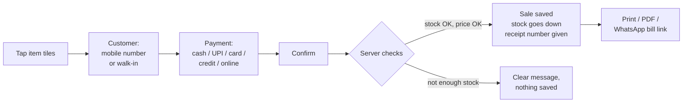

### Fitting job card

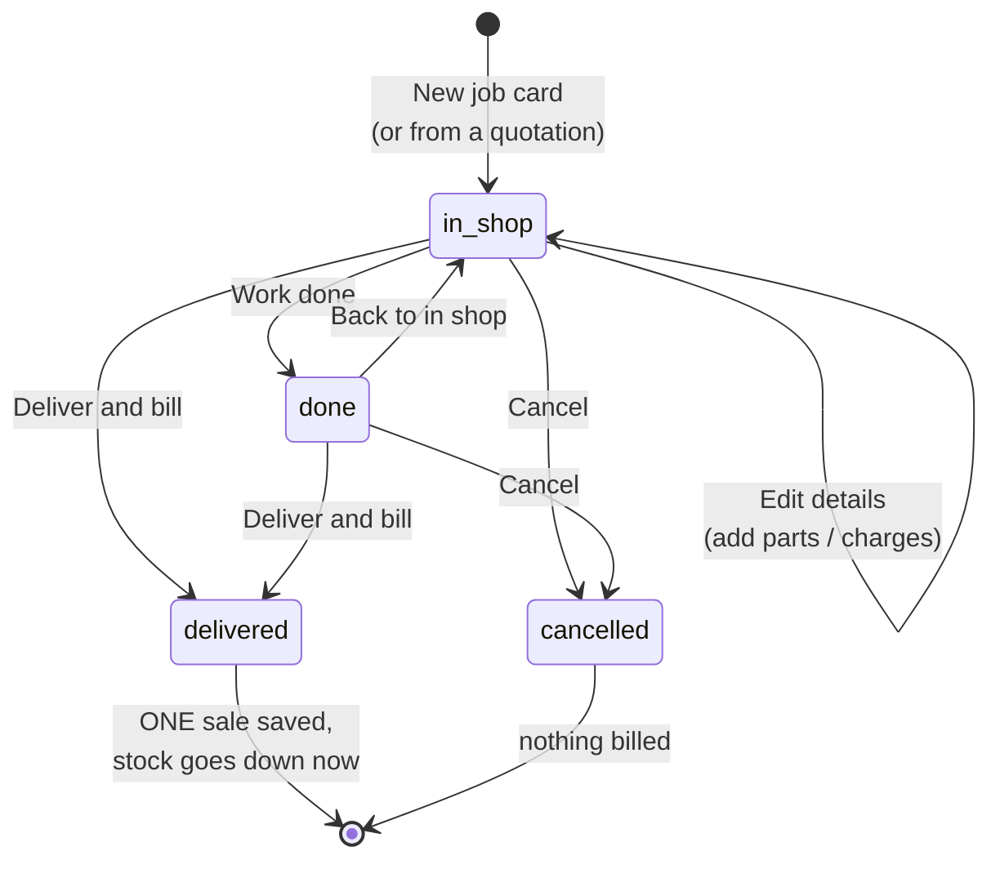

Each edit bumps a `version`; two partners editing the same job can't overwrite each other, and billing uses a fixed key per version, so tapping Deliver twice can never bill twice.

### Quotations

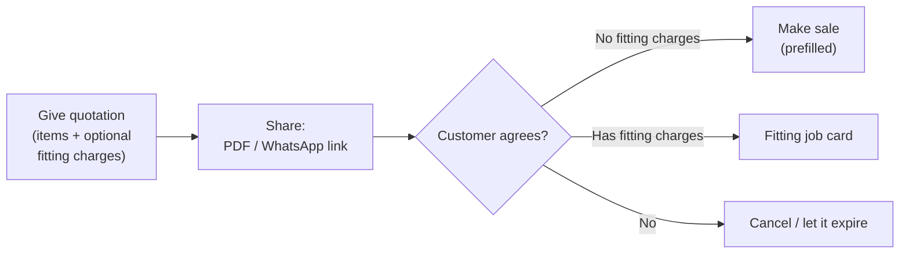

### Emails and background jobs

The worker also sends supplier emails (after partner approval), sale and AI-cost alerts, and owner reports. **No email or outside call ever happens inside a stock transaction:** the transaction writes an *outbox* row and the worker sends later, so a failed email never breaks a sale.

---

## 6. The database

Tables are defined in Python (`backend/app/infrastructure/database.py`), and every change is a numbered **Alembic migration**, so a database can be upgraded and rolled back step by step.

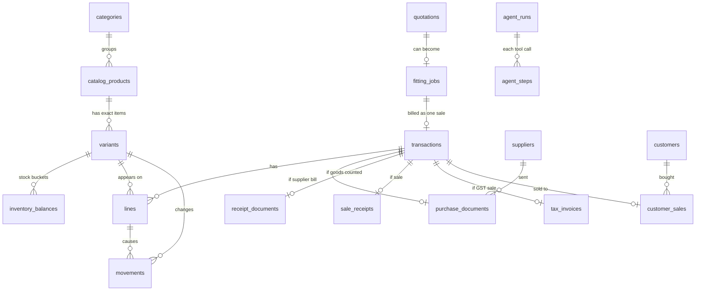

| Group | Tables | What they hold |
| --- | --- | --- |
| Catalogue | `categories`, `catalog_products`, `variants`, `unit_conversions` | Groups, families, exact items, confirmed pack sizes |
| Stock | `inventory_balances`, `movements` | Current numbers per bucket; every + / − with its reason |
| Documents | `transactions`, `lines` | Every business record, with a snapshot of name and price at that moment |
| Buying | `suppliers`, `purchase_documents`, `receipt_documents`, `unbilled_receipts` | Supplier bills, counted deliveries, goods with no bill |
| Selling | `sale_receipts`, `customers`, `quotations`, `fitting_jobs` | Receipts, encrypted customers, quotations, job cards |
| Safety | `requests`, `drafts`, `audit_events`, `outbox_events` | Request keys, drafts awaiting approval, who-did-what log, worker jobs |
| AI | `agent_runs`, `agent_steps`, `ai_monthly_budget` + read-only views in schema `ai` | Questions, every tool call and result, money spent |

---

## 7. Security and privacy

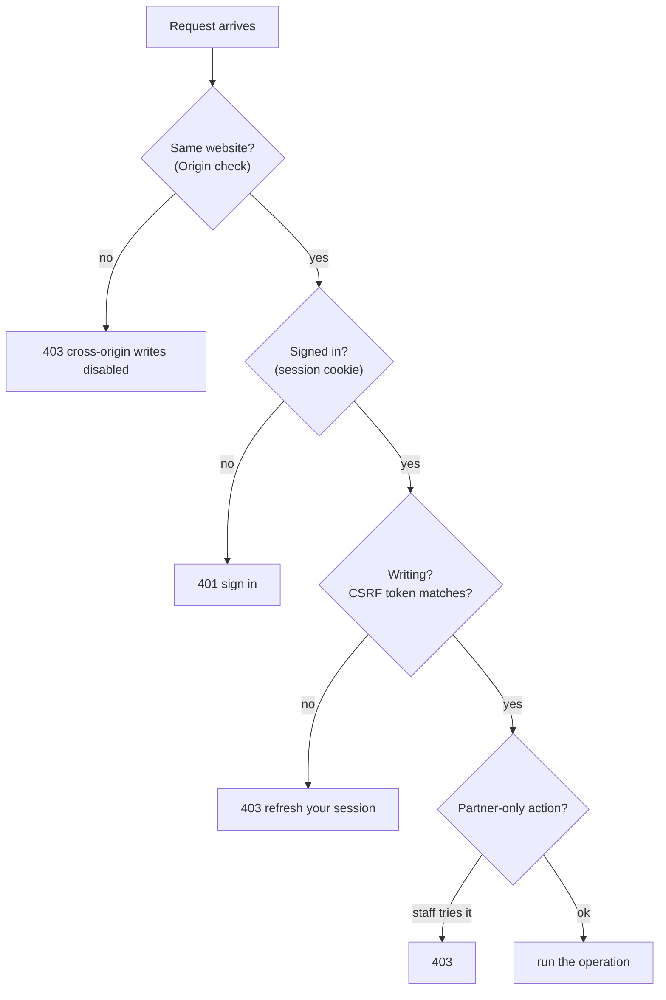

| Protection | How |
| --- | --- |
| Passwords | Argon2 hashes; never stored plain |
| Sessions | Random token in a Secure, HttpOnly, SameSite cookie; only its hash is stored |
| CSRF | Every write must carry the session's CSRF token |
| Lockout | Repeated wrong passwords lock sign-in for a while |
| Roles | Partner-only actions; staff never see buying prices |
| Customer data | Names and phones **encrypted** (Fernet); found by a keyed hash of the phone; never in audit rows or AI prompts |
| Share links | Random token, only its hash stored, expire, show one PDF only, `noindex` |
| Browser hardening | Content-Security-Policy, `nosniff`, `no-store` caching |
| Server | Only HTTPS is public; app and database listen only inside the server |

**Rules the app never breaks:** customer names and phones never go to the AI or any outside site; no GSTIN, HSN code or tax rate is ever guessed; test data and shop data are never mixed (deploys copy code only); secrets never go in git.

---

## 8. The AI assistant

### 8.1 How a question is answered

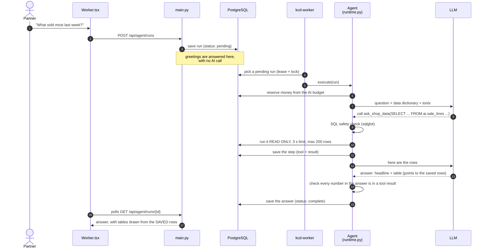

### 8.2 Why the AI can't make numbers up

1. It reads data only through **`ask_shop_data`**: one SQL `SELECT` over simple views in a separate `ai` schema (items, sales, sale lines, purchases, stock moves, open orders, suppliers).
2. **Four safety layers:** the SQL is parsed (one SELECT, only allowed views, no writes or system functions) → it runs in a **read-only transaction** → with a **3-second timeout** → and at most **200 rows**.
3. The views contain **no customer, phone, login, payment or email data**. Buying-price views are partner-only.
4. Every number in the answer's headline must appear in this run's tool results, or the model must retry.
5. Tables are drawn by the app from stored rows, not typed by the model.

### 8.3 Changes need a partner's "yes"

| Tool | What it does | Approval? |
| --- | --- | --- |
| `ask_shop_data`, `lookup_catalogue`, `verify_transaction`, `read_draft` | read only | no |
| `extract_document` | read an uploaded bill (text PDFs locally; scans via OCR) | no |
| `prepare_intake`, `prepare_purchase`, `prepare_receipt` | create an **editable draft** in Approvals | no (only a draft) |
| `post_approved_draft` | save a draft the partner approved (exact version) | yes, in Approvals |
| `change_selling_price`, `record_damaged`, `record_sale` | change data | yes, the exact change in the chat |
| `prepare_supplier_email` | draft an email | yes, before sending |

After any change, the tool **reads the record back** and reports whether it is verified.

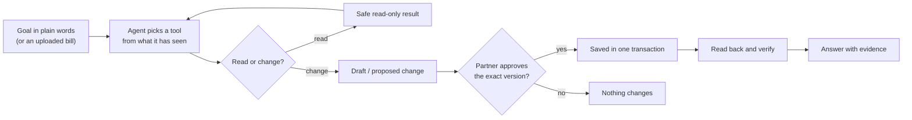

### 8.4 HSN code and GST rate answers

A small **checked loop**, not free writing: a rule book of car-accessory rules → if none fits, the model suggests search words, the **official HSN list** is searched and the model picks a code **from that short list** → code checks the code exists, breaks no rule and has a rate in the official schedule (retry at most twice) → a fixed template writes the answer. The model never types codes or rates itself.

### 8.5 Cost control

Before every model call, the worst-case cost is **reserved** against a monthly and daily budget; calls past the limit are refused. Each question has a cap on model requests and tool calls, and repeating the same tool call is blocked. AI can be switched off entirely and the shop keeps working.

---

## 9. Run this repository

You need Python 3.12+, uv, Node 22.12+ with npm, and PostgreSQL 18 binaries. On macOS, the setup script uses `/opt/homebrew/opt/postgresql@18/bin`. Set `KCD_PG_BIN` if your PostgreSQL binaries are elsewhere.

```bash
git clone https://github.com/Enoshraju7-prog/kakinada-car-decors-worker.git
cd kakinada-car-decors-worker/backend
uv sync --locked --extra ai
.venv/bin/python -m scripts.setup_local
cd ../frontend
npm ci --ignore-scripts
npm run build
cd ..
./dev.sh
```

Open [localhost:8000](http://127.0.0.1:8000/). The username is `partner`; setup saves the generated password privately in `data/local-access.txt`. It also creates ignored configuration files and separate demo, shop and test databases. Existing records are preserved.

To use AI, privately configure the Azure values listed in `backend/.env.example`. This code does not create an Azure resource or provide API keys. In another terminal, start the worker for the database configured in that file:

```bash
cd backend
.venv/bin/python -m app.infrastructure.jobs
```

Use generated bills for testing. Manual product entry, receiving and sales work without Azure.

### Repeat the controlled generated test

```bash
cd backend
.venv/bin/python -m scripts.evaluation setup
.venv/bin/python -m scripts.evaluation api
```

Open [localhost:8001](http://127.0.0.1:8001/), sign in and attach `output/pdf/generated-evaluation-bill.pdf` in AI assistant. Use this exact prompt:

> Process the attached generated evaluation bill. Match its printed SKU and unit to the catalogue, check duplicates, prepare its purchase draft, request partner approval, then post and read it back. Do not receive goods from the bill alone.

Copy the run ID shown on screen and run:

```bash
.venv/bin/python -m scripts.evaluation work RUN_ID
```

Review the draft in the app. Approve it, then run the same command again to continue. This evaluation runner accepts only its generated fixtures and exact test goals. The normal worker accepts other natural-language goals.

More detail: [demo prompts](docs/DEMO.md) · [architecture notes](docs/ARCHITECTURE.md) · [test results](docs/VERIFICATION.md) · [provenance](docs/PROVENANCE.md) · [customer checkout](docs/CUSTOMER_CHECKOUT.md) · [receipts](docs/SALES_RECEIPTS.md) · [sales history](docs/SALES_HISTORY.md)

---

## 10. What I tested in this snapshot

- **56 backend tests passed** using PostgreSQL. Frontend typecheck, build and formatting passed.
- Actual Azure extraction saved a generated bill as an editable draft.
- After partner review, the AI requested approval, posted the purchase and verified it.
- The browser received **10**, sold **3** and showed **7 left**. Independent database checks matched the stock history.
- A separate AI goal created and read back a shortage report.

[Saved flow evidence](artifacts/submission-oct8-stock.json). Physical counts and checkout were entered through the partner interface; the AI did not observe a delivery.

```bash
cd backend
.venv/bin/python -c 'from dotenv import load_dotenv; load_dotenv(".env"); import unittest; result=unittest.TextTestRunner(verbosity=2).run(unittest.defaultTestLoader.discover("tests")); raise SystemExit(not result.wasSuccessful())'
cd ../frontend
npm run build
npm run format:check
```

Backend tests require a separate `KCD_TEST_DATABASE_URL` ending in `/kcd_test`; they clear that test database.

Since this snapshot, the private product has grown to **600+ tests** against a real PostgreSQL database, including two phones selling the last piece at the same moment (exactly one succeeds, stock never goes below 0), replayed requests, partial deliveries, returns, quotations, fitting jobs, the AI's SQL safety check and the AI budget.

---

## 11. Limits and next work

Handwritten bills and vague product names can confuse the AI. One upload run saved a draft but kept asking unnecessary questions; I kept that failure in the evidence. I do not claim every invoice will work. Partners confirm uncertain variants, units, prices and physical deliveries; unknown pack conversions are rejected. The worker uses only this app's tools and cannot control arbitrary websites.

Next: simpler corrections, more bill tests, better mobile receiving, profit reports, and online payments once the shop's payment account is approved.

---

## 12. Glossary

| Word | Meaning |
| --- | --- |
| **Variant / item** | One exact thing that has stock (e.g. *Swift seat cover, black, set*) |
| **Family** | A group of variants (*seat covers*) |
| **Paise** | 1/100 rupee; all money is stored as whole paise |
| **Transaction / document** | One business record: purchase, receipt, sale, return, adjustment, reversal |
| **Movement** | One + or − of stock caused by a document |
| **Incoming** | Billed but not yet physically counted |
| **Draft** | A proposed change waiting for a partner's approval |
| **Request key** | A unique id per action so a retry never saves twice |
| **CSRF token** | A per-session secret proving a write came from our own page |
| **Migration** | A numbered script that changes the database tables |
| **Outbox** | Rows telling the worker "send this later", kept outside the stock transaction |
| **HSN** | The official code that decides an item's GST rate |

---

## 13. Credits

Built by Enosh Raju for Kakinada Car Decors, with AI coding assistants (OpenAI Codex, Claude Code). Main libraries: FastAPI, Pydantic, SQLAlchemy, Alembic, PostgreSQL, PydanticAI, ReportLab, sqlglot, Argon2, cryptography, React, TypeScript, Vite, Tailwind CSS, shadcn/ui + Radix, Lucide icons. Components and references are listed in [provenance](docs/PROVENANCE.md).
